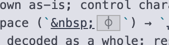

# Escape Lens

Inline badges that reveal the real characters behind escape sequences — placed right next to them in the editor. Matched escape sequences are underlined.

## Screenshot



> **Screenshot placeholder** — capture the real thing by pressing `F5`, opening
> `test-fixtures/sample.txt` in the Extension Development Host, and saving the
> screenshot as `docs/preview.png`.

## What it shows

| Escape sequence | Badge |
| --- | --- |
| `\n` `\t` `\r` `\0` … | `␊` `␉` `␍` `␀` (control characters use Unicode control-picture symbols) |
| `\x41` `\u003e` `\u{1F600}` | `A` `>` `😀` |
| `\\` `\'` `\"` | `\` `'` `"` |
| `&lt;` `&amp;` `&#62;` `&#x3e;` | `<` `&` `>` `>` |
| `%3C` `%20` `%E4%B8%AD` | `<` `␣` `中` (consecutive `%HH` runs decoded as multi-byte UTF-8) |

## Getting started

```bash
npm install
npm run build
```

Open this folder in VSCode, press `F5` ("Run Extension") to launch the
Extension Development Host, and open `test-fixtures/sample.txt`.

## Commands

- **Escape Lens: Toggle** — turn the badges on/off (also available from the status bar item)

## Configuration

| Setting | Default | Description |
| --- | --- | --- |
| `escapeLens.enabled` | `true` | Master switch |
| `escapeLens.backslash` | `true` | Detect backslash escapes (`\n`, `\u003e`, …) |
| `escapeLens.htmlEntities` | `true` | Detect HTML entities (`&lt;`, `&#62;`, …) |
| `escapeLens.urlEncoding` | `true` | Detect URL percent-encoding (`%3C`, `%E4%B8%AD`, …) |

## Display rules

- Printable characters are shown as-is; control characters use Control Pictures symbols (LF → `␊`, TAB → `␉`, DEL → `␡`)
- Space → `␣`, non-breaking space (`&nbsp;`) → `⍽`
- Consecutive URL escapes are decoded as a whole; results longer than 12 characters are truncated with `…`
- Zero-width characters (ZWJ etc.) have no visible glyph and are skipped
- Invalid code points (surrogates, beyond Unicode) and unknown named entities are not marked

## How it works

- Built on the editor decoration API (`createTextEditorDecorationType` + `setDecorations`); each match renders its own badge via `renderOptions.after.contentText`, and the matched text itself is underlined
- Full-document regex scan with a 200 ms debounce; files larger than 2 MB are skipped
- Decoding lives in `src/decoder.ts` / `src/matchers.ts` as pure functions — verify them with `npm run smoke`; `npm run test` runs an activation test in a real extension host

## Known limitations

- Matches everywhere in the file — no distinction between string literals, comments and code (v1 trade-off)
- Plain prose can rarely trigger a false positive for URL encoding (`100%beef` is already handled by the single-high-byte rule; otherwise disable `escapeLens.urlEncoding`)
- The built-in named entity table covers the full HTML4 set, not every HTML5 entity

## Packaging

```bash
npm run package
```
